# Telemetry <-> PassMark Score Correlation Report (Linux)

Generated from `Results` - 7 runs with usable data (PassMark + SoCWatch, EMON).

## Test-Bed Configuration

- **CPU**: Intel(R) Core(TM) Ultra 7 366H

- **Cores (per socket)**: 16

- **Memory (free -h, total)**: 62Gi

- **BIOS**: PTLPFWI1.R00.3515.D56.2601280733

- **GPU**: 00:02.0 VGA compatible controller: Intel Corporation Device b0a0

- **OS**: Ubuntu 24.04.5 LTS

- **Power profile**: varies per run (3 profiles tested: performance, performance+performance-gov, power-saver) - see breakdown below.

- **CPU power settings per profile** (governor / EPP / ACPI platform profile):

  - `performance`: governor `powersave`, EPP `performance`, platform profile `performance`

  - `performance+performance-gov`: governor `performance`, EPP `performance`, platform profile `performance`

  - `power-saver`: governor `None`, EPP `None`, platform profile `None`

## Methodology

Metric correction: historical IPC labels referred to `INST_RETIRED.ANY /
CPU_CLK_UNHALTED.REF_TSC`, instructions per unhalted reference cycle, not
actual core cycles. Values are unchanged; derived columns are now
`instructions_per_ref_cycle` and `avg_instructions_per_ref_cycle`. The latter
equally weights valid core/sample ratios, excluding zero-reference samples.
Conventional IPC is unavailable because these archived captures lack an
actual-core-cycle event.

- **PassMark** supplies one composite/sub-test score per run, read from the structured `results_*.yml` file PassMark writes (not the raw console text in `PassMark_PerfRes.txt`).
- **SoCWatch** (`socwatch/socwatch.csv`) supplies whole-run summary telemetry: average package power (mW), average active CPU frequency excluding idle time (MHz), and package C-state residency (% time in PC0 = active).
- **EMON** (`emon.csv`), where present, supplies ~1-sample/sec counters across the full run; these were averaged into run-level instructions/ref cycle and last-level-cache-miss-rate metrics.
- Each **run becomes one observation**; correlation (Pearson r) is computed **across runs** between score metrics and telemetry metrics.
- WARNING: **Caveat** - with **n=7** runs on a single SKU/system (one run per power profile), these are exploratory correlations, not statistically robust conclusions:
  - Each PassMark score is itself already an average across the run's internal iterations, so the *score* values have reasonably low pure benchmark-noise.
  - Telemetry (SoCWatch/EMON) was captured once per run, not separately per iteration - so iteration-to-iteration telemetry variance (e.g., thermal ramp) isn't visible, and runs were executed back-to-back without controlling for thermal/background-state carryover between power-profile switches.
  - With only a handful of distinct conditions, a single atypical profile can dominate the fit - treat any p<0.05 here as a directional signal worth repeat-testing, not a finalized regression.

## Per-Run Summary Table

|             run | power_plan                  |   SUMM_CPU |   SUMM_ME |   CPU_INTEGER_MATH |   CPU_FLOATINGPOINT_MATH |   CPU_PRIME |   CPU_SORTING |   CPU_ENCRYPTION |   CPU_COMPRESSION |   CPU_SINGLETHREAD |   CPU_PHYSICS |   ME_ALLOC_S |   ME_READ_S |   ME_READ_L |   ME_WRITE |   ME_LARGE |   ME_LATENCY |   ME_THREADED |   avg_pkg_power_mW |   avg_active_freq_mhz |   pkg_c0_pct |   avg_instructions_per_ref_cycle |   avg_cache_miss_per_kinst |   collection_duration_sec |
|----------------:|:----------------------------|-----------:|----------:|-------------------:|-------------------------:|------------:|--------------:|-----------------:|------------------:|-------------------:|--------------:|-------------:|------------:|------------:|-----------:|-----------:|-------------:|--------------:|-------------------:|----------------------:|-------------:|----------:|---------------------------:|--------------------------:|
| 20261104_073216 | performance                 |    30802.9 |   3769.42 |            90600.9 |                 104318   |      196.79 |       38760.5 |          24657.2 |            275471 |            4399.88 |       3200.46 |      9409.91 |     35091.9 |     23192.3 |   16270.8  |    57759.6 |        41.28 |       89887.8 |           21603.5  |               2950.12 |        99.02 |      1.64 |                      20.99 |                    279.13 |
| 20261104_073659 | power-saver                 |    14610.1 |   1512.27 |            34726.7 |                  40853.8 |       70.4  |       21587.4 |          12197.4 |            156345 |            1437.54 |       1539.28 |      3992.79 |     11387.8 |     10596.3 |    8951.53 |    57819.8 |       105.68 |       33878.4 |            5615.07 |               1233.81 |        98.79 |      0.7  |                      22.95 |                    350.85 |
| 20261104_075827 | performance+performance-gov |    29904   |   3755.49 |            90187.7 |                 102591   |      173.76 |       37124.2 |          23901.7 |            268111 |            4404.14 |       2707.62 |      7357.72 |     35380   |     23438.2 |   16346.8  |    57704.3 |        41.37 |       90118.2 |           21557    |               2927.56 |        99.13 |      1.57 |                      21.08 |                    279.11 |
| 20261104_080450 | performance                 |    30714.3 |   3790.21 |            90614.2 |                 102691   |      195.18 |       38495.5 |          24716.4 |            274154 |            4414.34 |       3205.99 |      9442.96 |     35922.3 |     23711.2 |   16443.8  |    57656.2 |        41.57 |       89709.5 |           21547.1  |               2947.25 |        98.99 |      1.63 |                      21.9  |                    279.13 |
| 20261104_081132 | performance+performance-gov |    29866.7 |   3775.02 |            90513.6 |                 104484   |      172.79 |       37032.4 |          23849.4 |            267248 |            4386.99 |       2674.23 |      7361.86 |     36063.8 |     23776.6 |   16415.8  |    57660.3 |        41.45 |       90100.4 |           21651.3  |               2933.06 |        99.06 |      1.58 |                      20.91 |                    279.11 |
| 20261104_081815 | performance                 |    30677.8 |   3756.72 |            90347.1 |                 103863   |      195.1  |       38445.4 |          24651.9 |            272761 |            4423.11 |       3203.05 |      9449.12 |     35123.8 |     23611.5 |   16311.7  |    57615.2 |        41.85 |       89923   |           21619.3  |               2942.88 |        98.8  |      1.62 |                      22.18 |                    280.11 |
| 20261104_082458 | performance+performance-gov |    29902.7 |   3757.79 |            90511.9 |                 104869   |      172.74 |       37069.3 |          23845.7 |            267224 |            4388.73 |       2719.9  |      7369.22 |     35370   |     23494.7 |   16338.9  |    57608.4 |        41.33 |       90115.5 |           21666    |               2935    |        98.9  |      1.58 |                      22.65 |                    279.13 |

## Per-Run Detailed Plots (Side-by-Side by Plot Type)

Each completed run also has its own 4-plot deep-dive (generated by `analyze_run.py`), covering within-run telemetry trends the cross-run tables above don't show. Grouped here by plot type so runs/power profiles can be compared side by side.

### Timeseries overview (freq / instructions/ref cycle / cache-miss)

<table><tr>

<td align="center"><b>20261104_073216 performance</b> 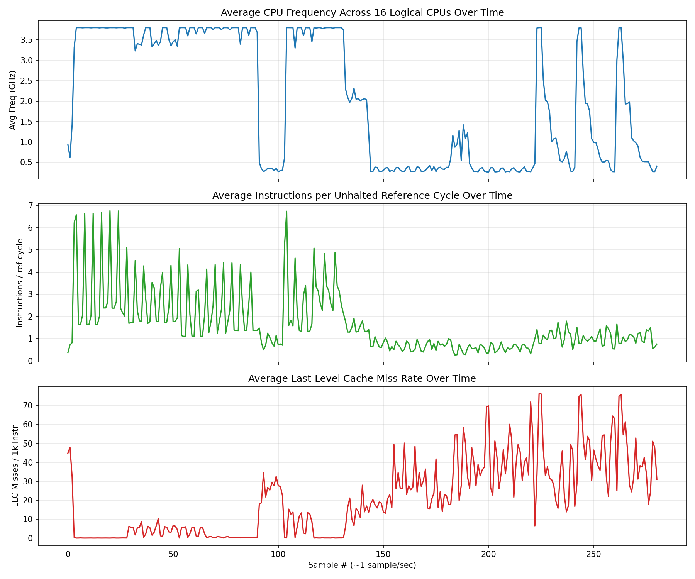</td>

<td align="center"><b>20261104_073659 power-saver</b> 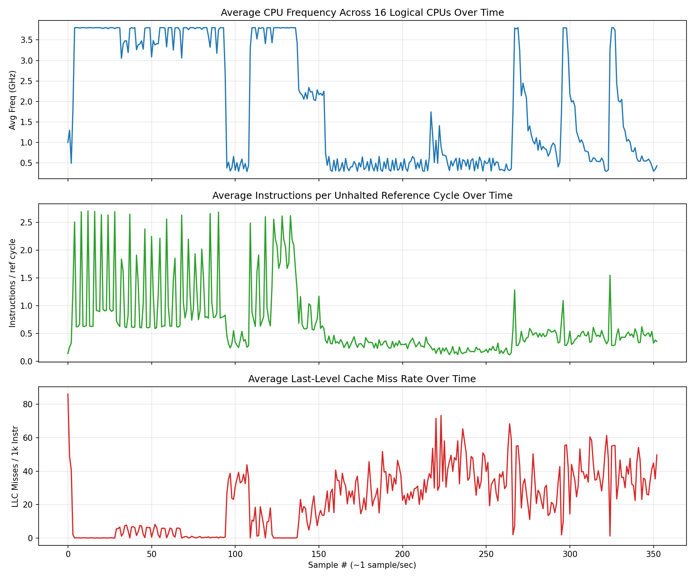</td>

<td align="center"><b>20261104_075827 performance+performance-gov</b> 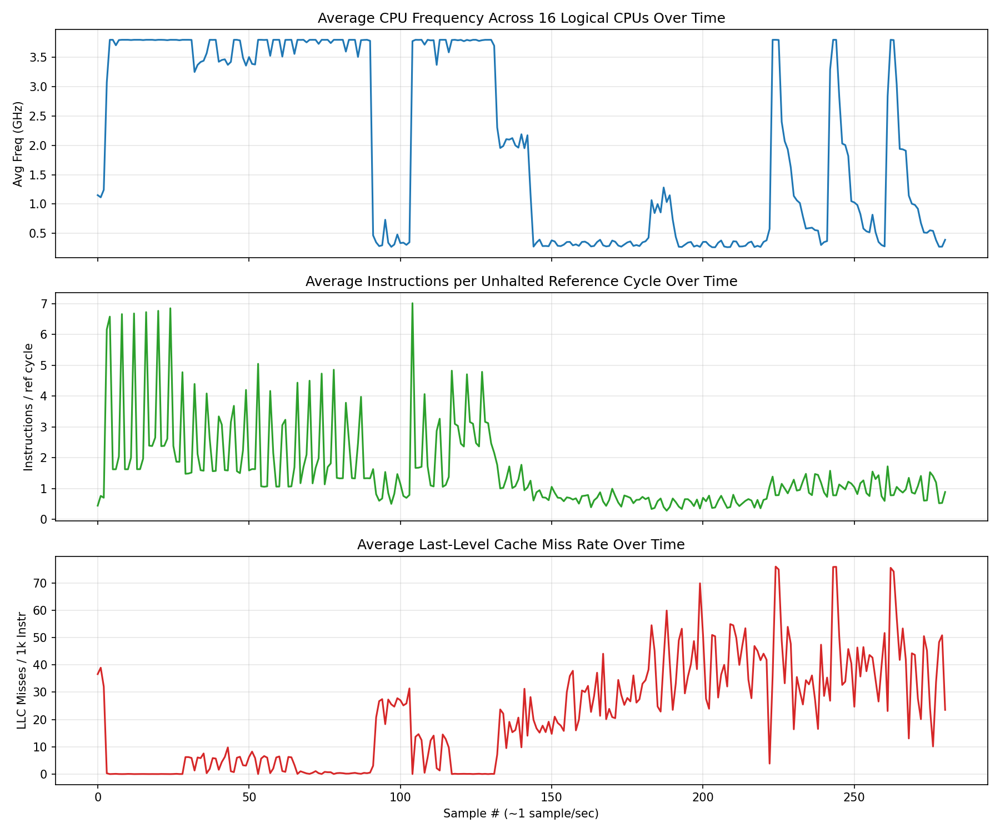</td>

<td align="center"><b>20261104_080450 performance</b> 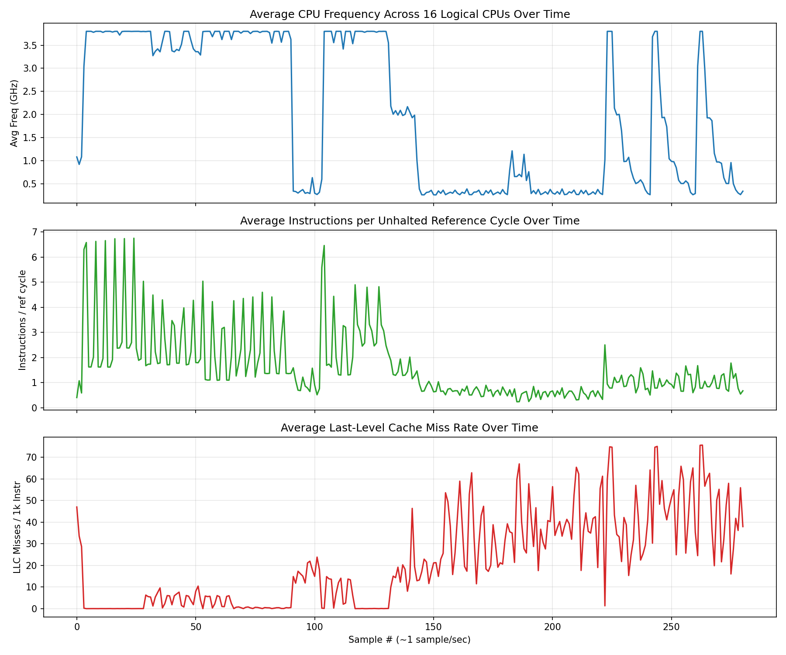</td>

<td align="center"><b>20261104_081132 performance+performance-gov</b> 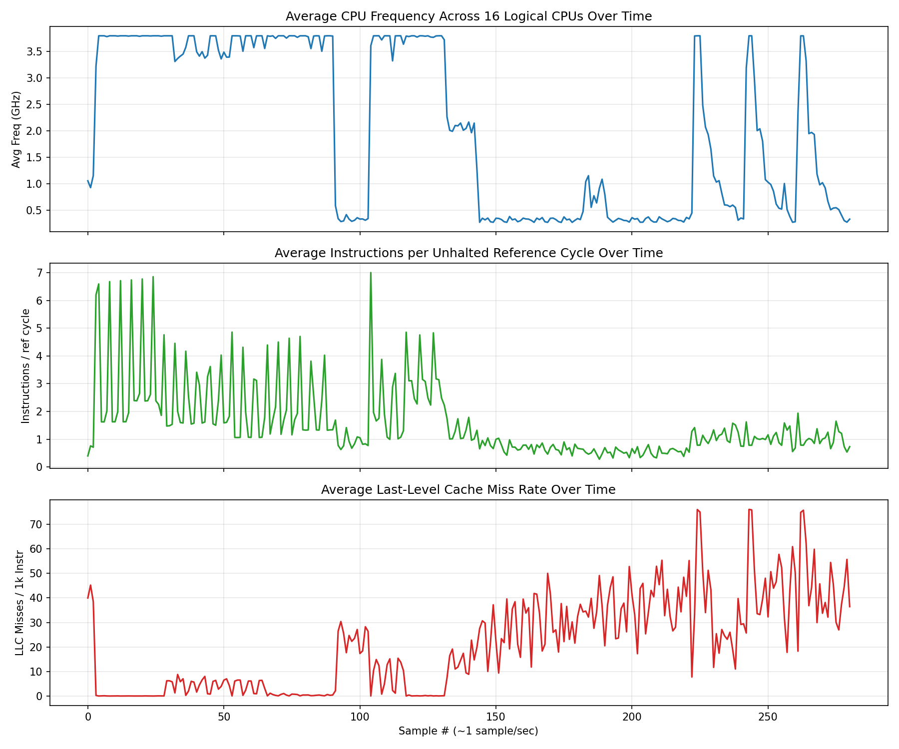</td>

<td align="center"><b>20261104_081815 performance</b> 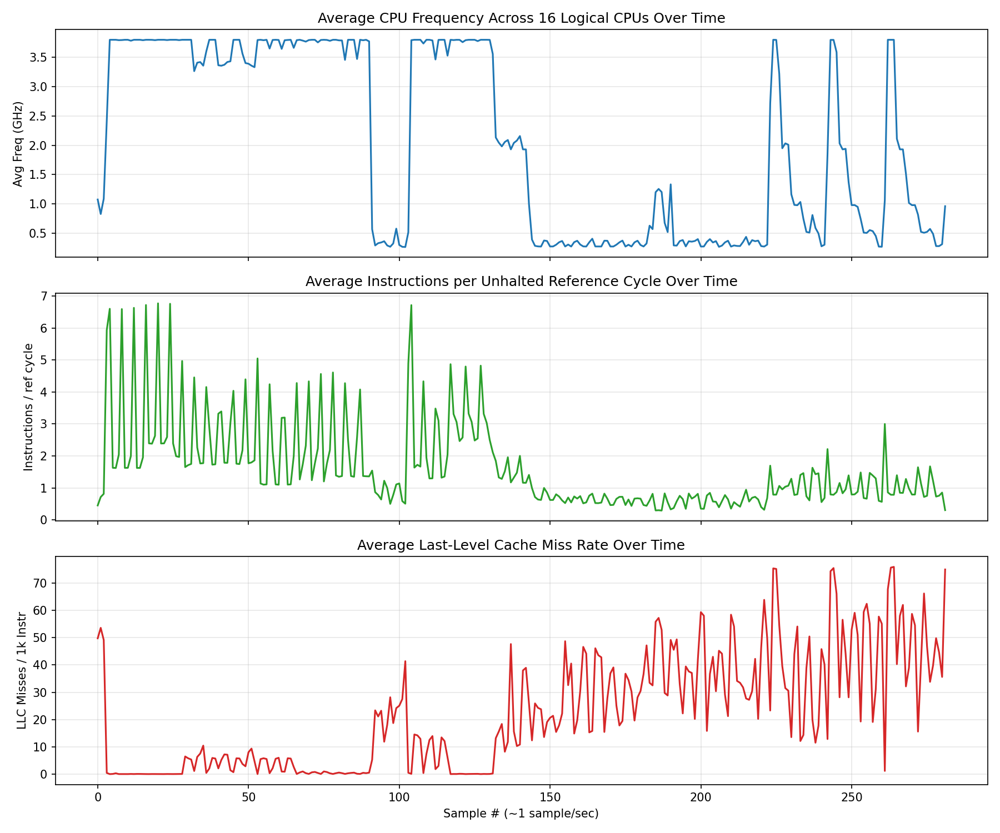</td>

<td align="center"><b>20261104_082458 performance+performance-gov</b> 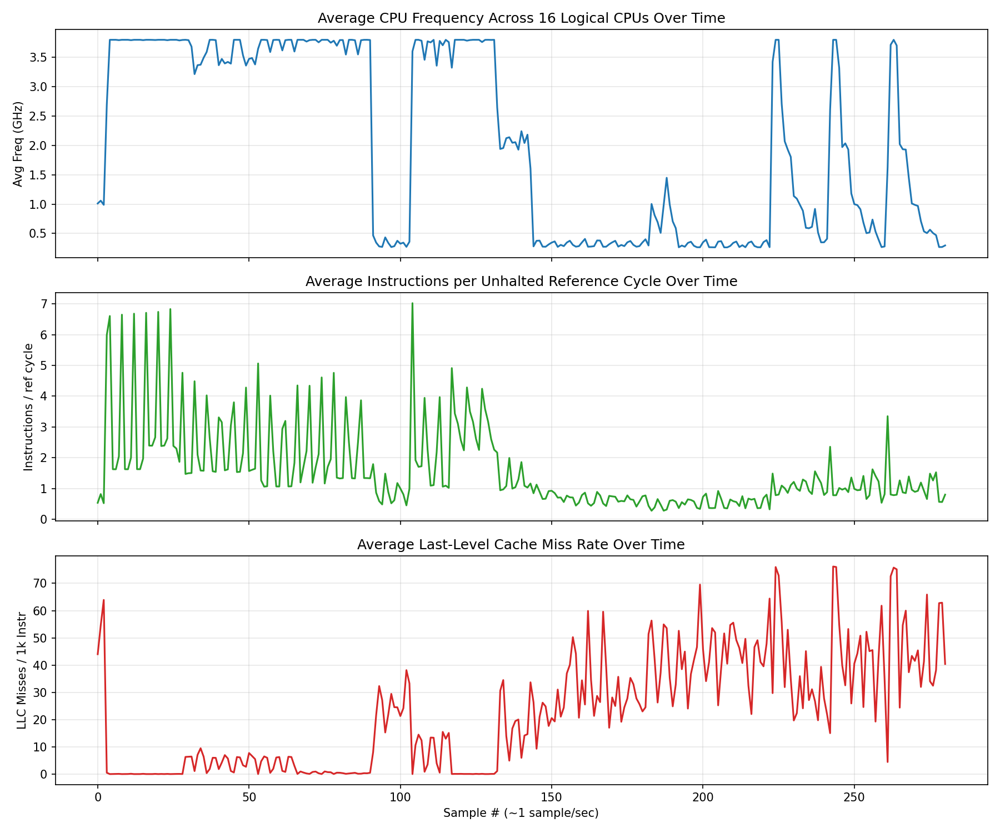</td>

</tr></table>

### Per-core frequency heatmap

<table><tr>

<td align="center"><b>20261104_073216 performance</b> 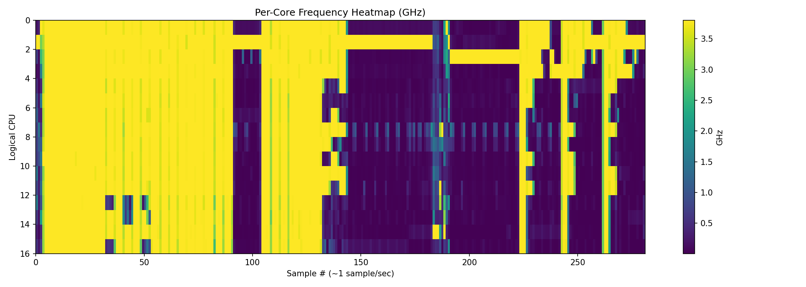</td>

<td align="center"><b>20261104_073659 power-saver</b> 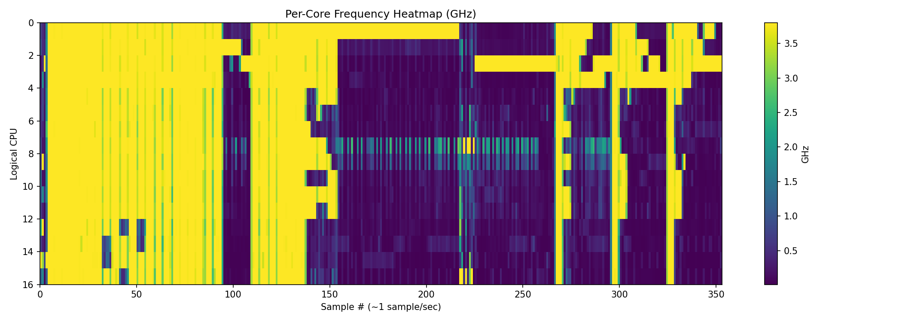</td>

<td align="center"><b>20261104_075827 performance+performance-gov</b> 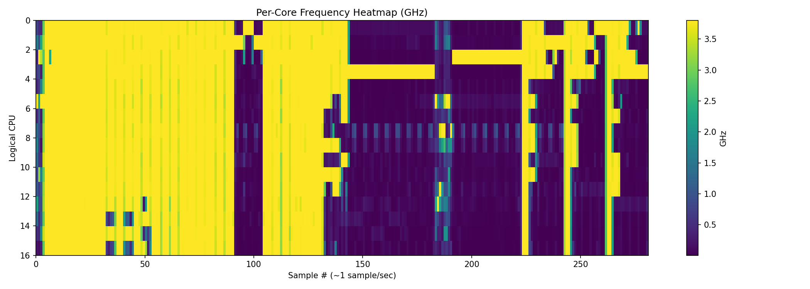</td>

<td align="center"><b>20261104_080450 performance</b> 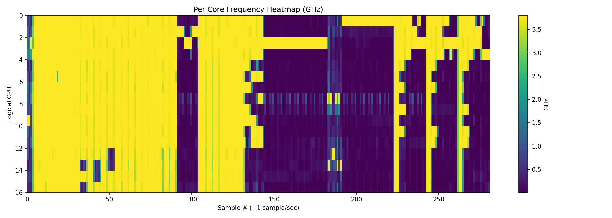</td>

<td align="center"><b>20261104_081132 performance+performance-gov</b> 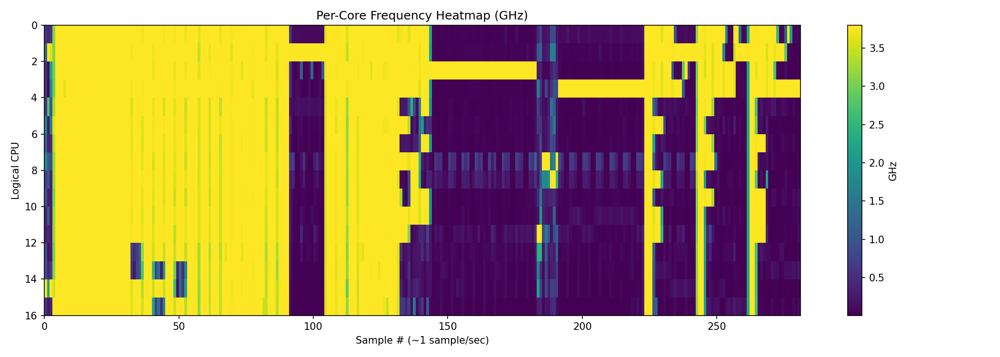</td>

<td align="center"><b>20261104_081815 performance</b> 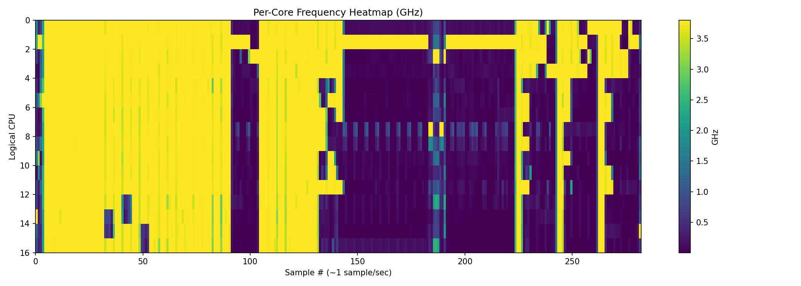</td>

<td align="center"><b>20261104_082458 performance+performance-gov</b> 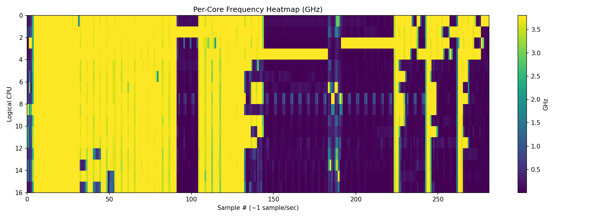</td>

</tr></table>

### C-state residency

<table><tr>

<td align="center"><b>20261104_073216 performance</b> </td>

<td align="center"><b>20261104_073659 power-saver</b> </td>

<td align="center"><b>20261104_075827 performance+performance-gov</b> 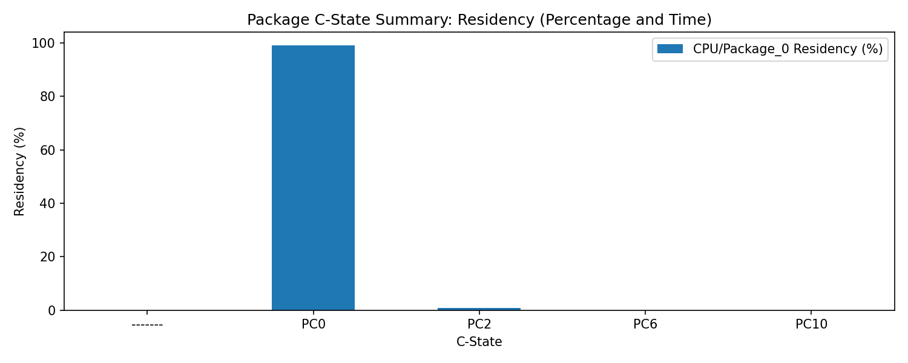</td>

<td align="center"><b>20261104_080450 performance</b> </td>

<td align="center"><b>20261104_081132 performance+performance-gov</b> </td>

<td align="center"><b>20261104_081815 performance</b> </td>

<td align="center"><b>20261104_082458 performance+performance-gov</b> </td>

</tr></table>

### PassMark sub-test scores

<table><tr>

<td align="center"><b>20261104_073216 performance</b> </td>

<td align="center"><b>20261104_073659 power-saver</b> 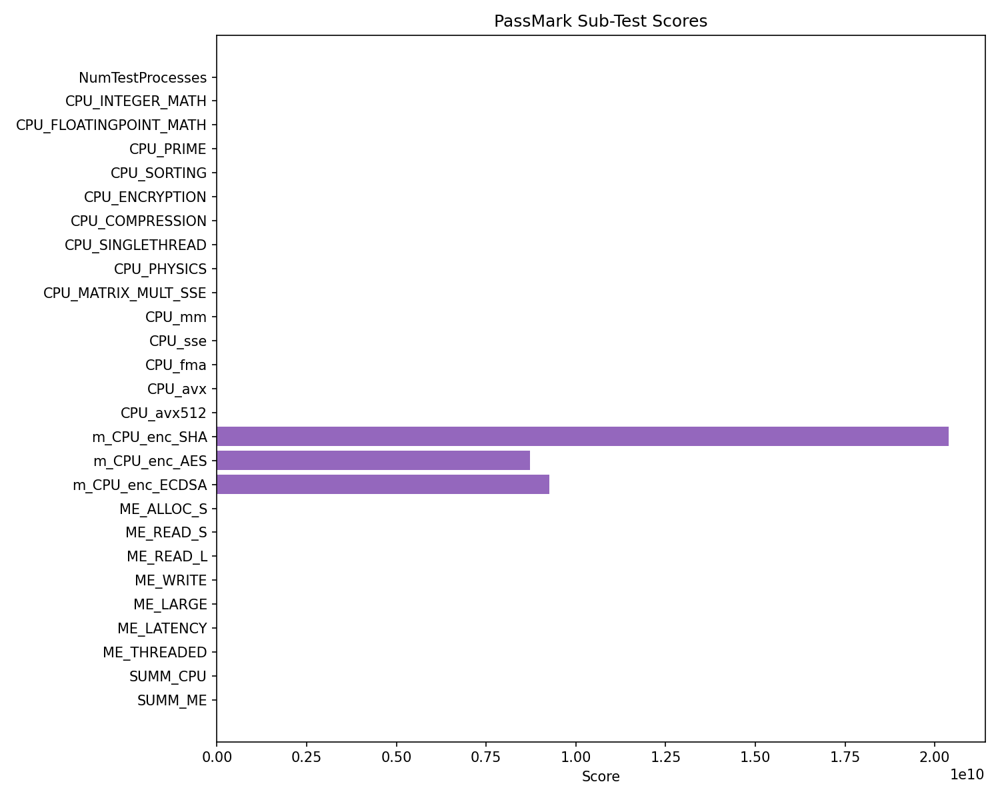</td>

<td align="center"><b>20261104_075827 performance+performance-gov</b> </td>

<td align="center"><b>20261104_080450 performance</b> </td>

<td align="center"><b>20261104_081132 performance+performance-gov</b> </td>

<td align="center"><b>20261104_081815 performance</b> </td>

<td align="center"><b>20261104_082458 performance+performance-gov</b> </td>

</tr></table>

## Comparison by Power Profile

Grouped mean per power profile (n = number of runs in that group). With few runs per group this is **descriptive, not statistically significant** - a starting point for which profile looks favorable per metric, confirm with repeats.

| power_plan                  |   n |   SUMM_CPU |   SUMM_ME |   CPU_INTEGER_MATH |   CPU_FLOATINGPOINT_MATH |   CPU_PRIME |   CPU_SORTING |   CPU_ENCRYPTION |   CPU_COMPRESSION |   CPU_SINGLETHREAD |   CPU_PHYSICS |   ME_ALLOC_S |   ME_READ_S |   ME_READ_L |   ME_WRITE |   ME_LARGE |   ME_LATENCY |   ME_THREADED |   avg_pkg_power_mW |   avg_active_freq_mhz |   pkg_c0_pct |   avg_instructions_per_ref_cycle |   avg_cache_miss_per_kinst |   collection_duration_sec |
|:----------------------------|----:|-----------:|----------:|-------------------:|-------------------------:|------------:|--------------:|-----------------:|------------------:|-------------------:|--------------:|-------------:|------------:|------------:|-----------:|-----------:|-------------:|--------------:|-------------------:|----------------------:|-------------:|----------:|---------------------------:|--------------------------:|
| performance                 |   3 |    30731.7 |   3772.12 |            90520.7 |                 103624   |      195.69 |       38567.1 |          24675.1 |            274129 |            4412.44 |       3203.17 |      9433.99 |     35379.4 |     23505   |   16342.1  |    57677   |        41.56 |       89840.1 |           21590    |               2946.75 |        98.94 |      1.63 |                      21.69 |                    279.46 |
| performance+performance-gov |   3 |    29891.1 |   3762.77 |            90404.4 |                 103981   |      173.1  |       37075.3 |          23865.6 |            267528 |            4393.29 |       2700.58 |      7362.93 |     35604.6 |     23569.8 |   16367.2  |    57657.7 |        41.38 |       90111.4 |           21624.8  |               2931.88 |        99.03 |      1.58 |                      21.55 |                    279.12 |
| power-saver                 |   1 |    14610.1 |   1512.27 |            34726.7 |                  40853.8 |       70.4  |       21587.4 |          12197.4 |            156345 |            1437.54 |       1539.28 |      3992.79 |     11387.8 |     10596.3 |    8951.53 |    57819.8 |       105.68 |       33878.4 |            5615.07 |               1233.81 |        98.79 |      0.7  |                      22.95 |                    350.85 |

## Run-to-Run Repeatability (All Runs, Mixed Config)

Mean / standard deviation / coefficient of variation (CoV%) across **all** collected runs regardless of power profile - inflated by any power-profile differences above.

|                          |       mean |       std |   cov_pct |
|:-------------------------|-----------:|----------:|----------:|
| SUMM_CPU                 |  28068.4   |  5949.54  |     21.2  |
| SUMM_ME                  |   3445.27  |   852.466 |     24.74 |
| CPU_INTEGER_MATH         |  82500.3   | 21066.7   |     25.54 |
| CPU_FLOATINGPOINT_MATH   |  94809.9   | 23808.4   |     25.11 |
| CPU_PRIME                |    168.108 |    44.545 |     26.5  |
| CPU_SORTING              |  35502.1   |  6181.82  |     17.41 |
| CPU_ENCRYPTION           |  22545.7   |  4581.16  |     20.32 |
| CPU_COMPRESSION          | 254473     | 43404.4   |     17.06 |
| CPU_SINGLETHREAD         |   3979.25  |  1120.86  |     28.17 |
| CPU_PHYSICS              |   2750.07  |   590.253 |     21.46 |
| ME_ALLOC_S               |   7769.08  |  1960.95  |     25.24 |
| ME_READ_S                |  32048.5   |  9118.17  |     28.45 |
| ME_READ_L                |  21688.7   |  4895.08  |     22.57 |
| ME_WRITE                 |  15297     |  2798.73  |     18.3  |
| ME_LARGE                 |  57689.1   |    77.661 |      0.13 |
| ME_LATENCY               |     50.646 |    24.269 |     47.92 |
| ME_THREADED              |  81961.8   | 21203.3   |     25.87 |
| avg_pkg_power_mW         |  19322.8   |  6044.68  |     31.28 |
| avg_active_freq_mhz      |   2695.67  |   644.669 |     23.91 |
| pkg_c0_pct               |     98.956 |     0.13  |      0.13 |
| avg_instructions_per_ref_cycle                  |      1.475 |     0.344 |     23.34 |
| avg_cache_miss_per_kinst |     21.811 |     0.832 |      3.82 |
| collection_duration_sec  |    289.511 |    27.05  |      9.34 |

## Correlation Matrix

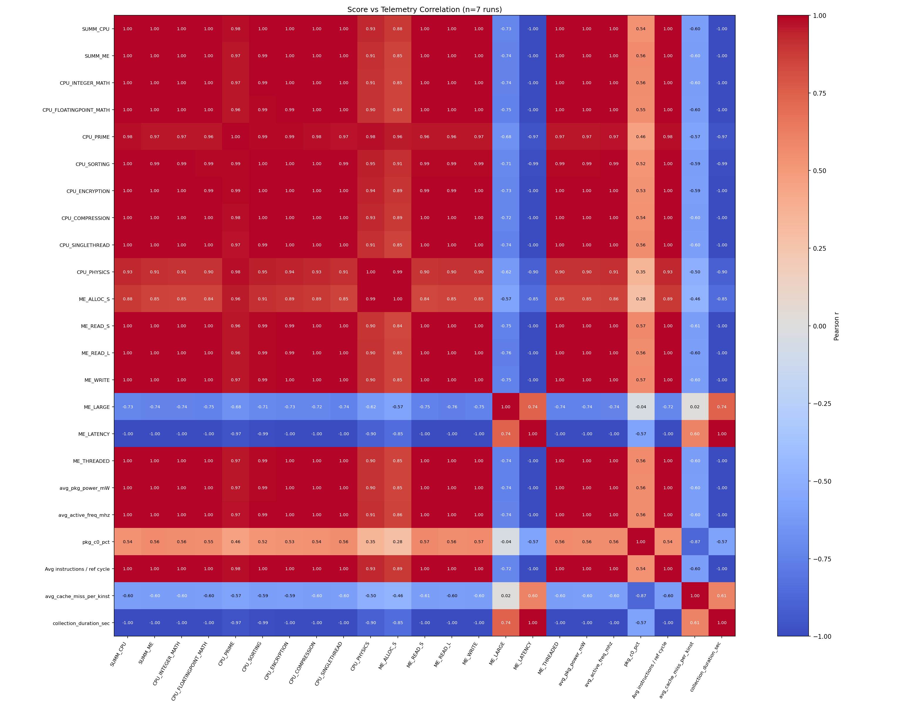

|                          |   SUMM_CPU |   SUMM_ME |   CPU_INTEGER_MATH |   CPU_FLOATINGPOINT_MATH |   CPU_PRIME |   CPU_SORTING |   CPU_ENCRYPTION |   CPU_COMPRESSION |   CPU_SINGLETHREAD |   CPU_PHYSICS |   ME_ALLOC_S |   ME_READ_S |   ME_READ_L |   ME_WRITE |   ME_LARGE |   ME_LATENCY |   ME_THREADED |   avg_pkg_power_mW |   avg_active_freq_mhz |   pkg_c0_pct |   avg_instructions_per_ref_cycle |   avg_cache_miss_per_kinst |   collection_duration_sec |
|:-------------------------|-----------:|----------:|-------------------:|-------------------------:|------------:|--------------:|-----------------:|------------------:|-------------------:|--------------:|-------------:|------------:|------------:|-----------:|-----------:|-------------:|--------------:|-------------------:|----------------------:|-------------:|----------:|---------------------------:|--------------------------:|
| SUMM_CPU                 |       1    |      1    |               1    |                     1    |        0.98 |          1    |             1    |              1    |               1    |          0.93 |         0.88 |        1    |        1    |       1    |      -0.73 |        -1    |          1    |               1    |                  1    |         0.54 |      1    |                      -0.6  |                     -1    |
| SUMM_ME                  |       1    |      1    |               1    |                     1    |        0.97 |          0.99 |             1    |              1    |               1    |          0.91 |         0.85 |        1    |        1    |       1    |      -0.74 |        -1    |          1    |               1    |                  1    |         0.56 |      1    |                      -0.6  |                     -1    |
| CPU_INTEGER_MATH         |       1    |      1    |               1    |                     1    |        0.97 |          0.99 |             1    |              1    |               1    |          0.91 |         0.85 |        1    |        1    |       1    |      -0.74 |        -1    |          1    |               1    |                  1    |         0.56 |      1    |                      -0.6  |                     -1    |
| CPU_FLOATINGPOINT_MATH   |       1    |      1    |               1    |                     1    |        0.96 |          0.99 |             0.99 |              1    |               1    |          0.9  |         0.84 |        1    |        1    |       1    |      -0.75 |        -1    |          1    |               1    |                  1    |         0.55 |      1    |                      -0.6  |                     -1    |
| CPU_PRIME                |       0.98 |      0.97 |               0.97 |                     0.96 |        1    |          0.99 |             0.99 |              0.98 |               0.97 |          0.98 |         0.96 |        0.96 |        0.96 |       0.97 |      -0.68 |        -0.97 |          0.97 |               0.97 |                  0.97 |         0.46 |      0.98 |                      -0.57 |                     -0.97 |
| CPU_SORTING              |       1    |      0.99 |               0.99 |                     0.99 |        0.99 |          1    |             1    |              1    |               0.99 |          0.95 |         0.91 |        0.99 |        0.99 |       0.99 |      -0.71 |        -0.99 |          0.99 |               0.99 |                  0.99 |         0.52 |      1    |                      -0.59 |                     -0.99 |
| CPU_ENCRYPTION           |       1    |      1    |               1    |                     0.99 |        0.99 |          1    |             1    |              1    |               1    |          0.94 |         0.89 |        0.99 |        0.99 |       1    |      -0.73 |        -1    |          1    |               1    |                  1    |         0.53 |      1    |                      -0.59 |                     -1    |
| CPU_COMPRESSION          |       1    |      1    |               1    |                     1    |        0.98 |          1    |             1    |              1    |               1    |          0.93 |         0.89 |        1    |        1    |       1    |      -0.72 |        -1    |          1    |               1    |                  1    |         0.54 |      1    |                      -0.6  |                     -1    |
| CPU_SINGLETHREAD         |       1    |      1    |               1    |                     1    |        0.97 |          0.99 |             1    |              1    |               1    |          0.91 |         0.85 |        1    |        1    |       1    |      -0.74 |        -1    |          1    |               1    |                  1    |         0.56 |      1    |                      -0.6  |                     -1    |
| CPU_PHYSICS              |       0.93 |      0.91 |               0.91 |                     0.9  |        0.98 |          0.95 |             0.94 |              0.93 |               0.91 |          1    |         0.99 |        0.9  |        0.9  |       0.9  |      -0.62 |        -0.9  |          0.9  |               0.9  |                  0.91 |         0.35 |      0.93 |                      -0.5  |                     -0.9  |
| ME_ALLOC_S               |       0.88 |      0.85 |               0.85 |                     0.84 |        0.96 |          0.91 |             0.89 |              0.89 |               0.85 |          0.99 |         1    |        0.84 |        0.85 |       0.85 |      -0.57 |        -0.85 |          0.85 |               0.85 |                  0.86 |         0.28 |      0.89 |                      -0.46 |                     -0.85 |
| ME_READ_S                |       1    |      1    |               1    |                     1    |        0.96 |          0.99 |             0.99 |              1    |               1    |          0.9  |         0.84 |        1    |        1    |       1    |      -0.75 |        -1    |          1    |               1    |                  1    |         0.57 |      1    |                      -0.61 |                     -1    |
| ME_READ_L                |       1    |      1    |               1    |                     1    |        0.96 |          0.99 |             0.99 |              1    |               1    |          0.9  |         0.85 |        1    |        1    |       1    |      -0.76 |        -1    |          1    |               1    |                  1    |         0.56 |      1    |                      -0.6  |                     -1    |
| ME_WRITE                 |       1    |      1    |               1    |                     1    |        0.97 |          0.99 |             1    |              1    |               1    |          0.9  |         0.85 |        1    |        1    |       1    |      -0.75 |        -1    |          1    |               1    |                  1    |         0.57 |      1    |                      -0.6  |                     -1    |
| ME_LARGE                 |      -0.73 |     -0.74 |              -0.74 |                    -0.75 |       -0.68 |         -0.71 |            -0.73 |             -0.72 |              -0.74 |         -0.62 |        -0.57 |       -0.75 |       -0.76 |      -0.75 |       1    |         0.74 |         -0.74 |              -0.74 |                 -0.74 |        -0.04 |     -0.72 |                       0.02 |                      0.74 |
| ME_LATENCY               |      -1    |     -1    |              -1    |                    -1    |       -0.97 |         -0.99 |            -1    |             -1    |              -1    |         -0.9  |        -0.85 |       -1    |       -1    |      -1    |       0.74 |         1    |         -1    |              -1    |                 -1    |        -0.57 |     -1    |                       0.6  |                      1    |
| ME_THREADED              |       1    |      1    |               1    |                     1    |        0.97 |          0.99 |             1    |              1    |               1    |          0.9  |         0.85 |        1    |        1    |       1    |      -0.74 |        -1    |          1    |               1    |                  1    |         0.56 |      1    |                      -0.6  |                     -1    |
| avg_pkg_power_mW         |       1    |      1    |               1    |                     1    |        0.97 |          0.99 |             1    |              1    |               1    |          0.9  |         0.85 |        1    |        1    |       1    |      -0.74 |        -1    |          1    |               1    |                  1    |         0.56 |      1    |                      -0.6  |                     -1    |
| avg_active_freq_mhz      |       1    |      1    |               1    |                     1    |        0.97 |          0.99 |             1    |              1    |               1    |          0.91 |         0.86 |        1    |        1    |       1    |      -0.74 |        -1    |          1    |               1    |                  1    |         0.56 |      1    |                      -0.6  |                     -1    |
| pkg_c0_pct               |       0.54 |      0.56 |               0.56 |                     0.55 |        0.46 |          0.52 |             0.53 |              0.54 |               0.56 |          0.35 |         0.28 |        0.57 |        0.56 |       0.57 |      -0.04 |        -0.57 |          0.56 |               0.56 |                  0.56 |         1    |      0.54 |                      -0.87 |                     -0.57 |
| avg_instructions_per_ref_cycle                  |       1    |      1    |               1    |                     1    |        0.98 |          1    |             1    |              1    |               1    |          0.93 |         0.89 |        1    |        1    |       1    |      -0.72 |        -1    |          1    |               1    |                  1    |         0.54 |      1    |                      -0.6  |                     -1    |
| avg_cache_miss_per_kinst |      -0.6  |     -0.6  |              -0.6  |                    -0.6  |       -0.57 |         -0.59 |            -0.59 |             -0.6  |              -0.6  |         -0.5  |        -0.46 |       -0.61 |       -0.6  |      -0.6  |       0.02 |         0.6  |         -0.6  |              -0.6  |                 -0.6  |        -0.87 |     -0.6  |                       1    |                      0.61 |
| collection_duration_sec  |      -1    |     -1    |              -1    |                    -1    |       -0.97 |         -0.99 |            -1    |             -1    |              -1    |         -0.9  |        -0.85 |       -1    |       -1    |      -1    |       0.74 |         1    |         -1    |              -1    |                 -1    |        -0.57 |     -1    |                       0.61 |                      1    |

## Strongest Score <-> Telemetry Relationships

| Score | Telemetry | r | p-value | n |
|---|---|---|---|---|

| ME_THREADED | avg_pkg_power_mW | 1.00 | 0.000 | 7 |

| ME_LATENCY | collection_duration_sec | 1.00 | 0.000 | 7 |

| CPU_INTEGER_MATH | avg_pkg_power_mW | 1.00 | 0.000 | 7 |

| CPU_INTEGER_MATH | avg_active_freq_mhz | 1.00 | 0.000 | 7 |

| ME_LATENCY | avg_pkg_power_mW | -1.00 | 0.000 | 7 |

| CPU_SINGLETHREAD | avg_active_freq_mhz | 1.00 | 0.000 | 7 |

| SUMM_CPU | avg_instructions_per_ref_cycle | 1.00 | 0.000 | 7 |

| CPU_INTEGER_MATH | collection_duration_sec | -1.00 | 0.000 | 7 |

| SUMM_ME | avg_active_freq_mhz | 1.00 | 0.000 | 7 |

| CPU_COMPRESSION | avg_instructions_per_ref_cycle | 1.00 | 0.000 | 7 |

## Scatter Plots (Top 6 by |r|)

### ME_THREADED vs avg_pkg_power_mW (r=1.00, p=0.000, n=7)

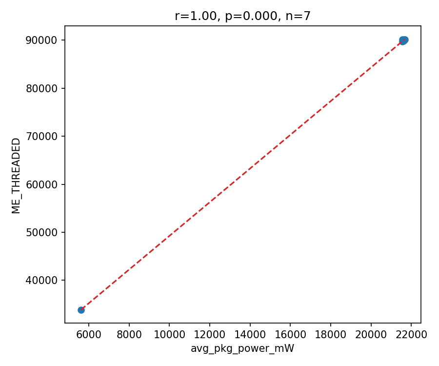

### ME_LATENCY vs collection_duration_sec (r=1.00, p=0.000, n=7)

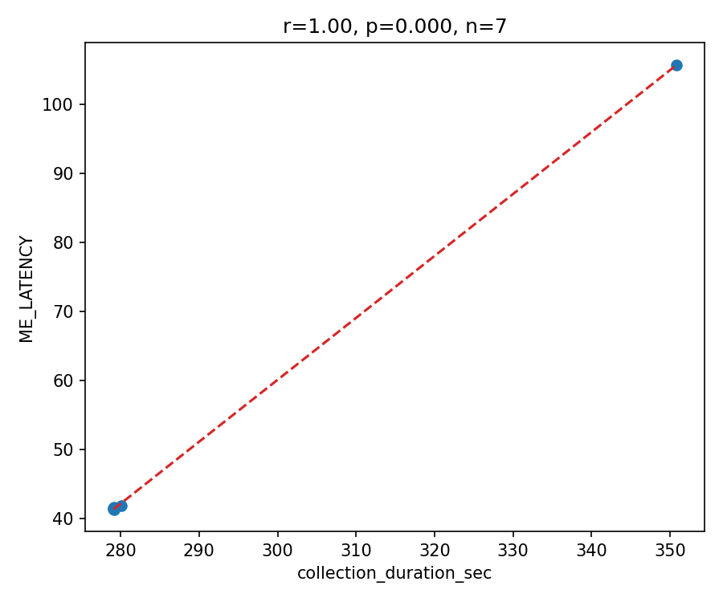

### CPU_INTEGER_MATH vs avg_pkg_power_mW (r=1.00, p=0.000, n=7)

### CPU_INTEGER_MATH vs avg_active_freq_mhz (r=1.00, p=0.000, n=7)

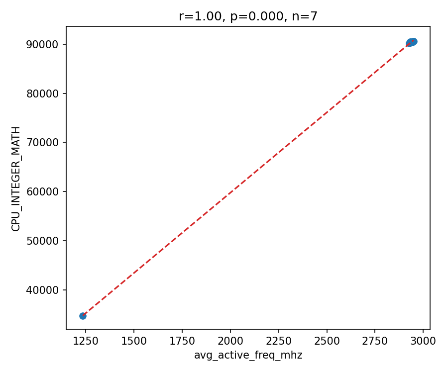

### ME_LATENCY vs avg_pkg_power_mW (r=-1.00, p=0.000, n=7)

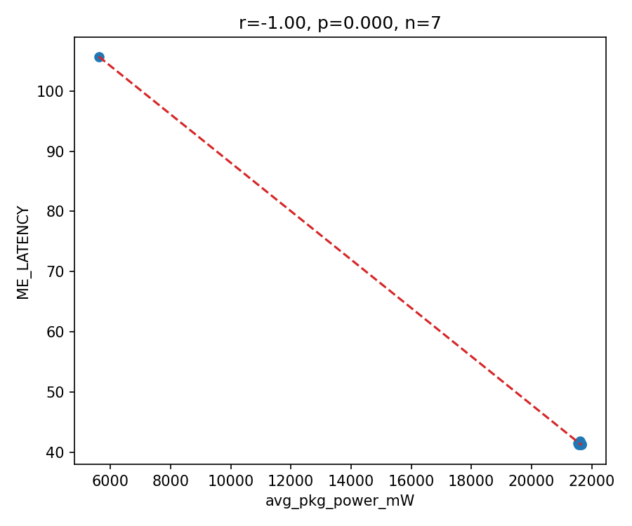

### CPU_SINGLETHREAD vs avg_active_freq_mhz (r=1.00, p=0.000, n=7)

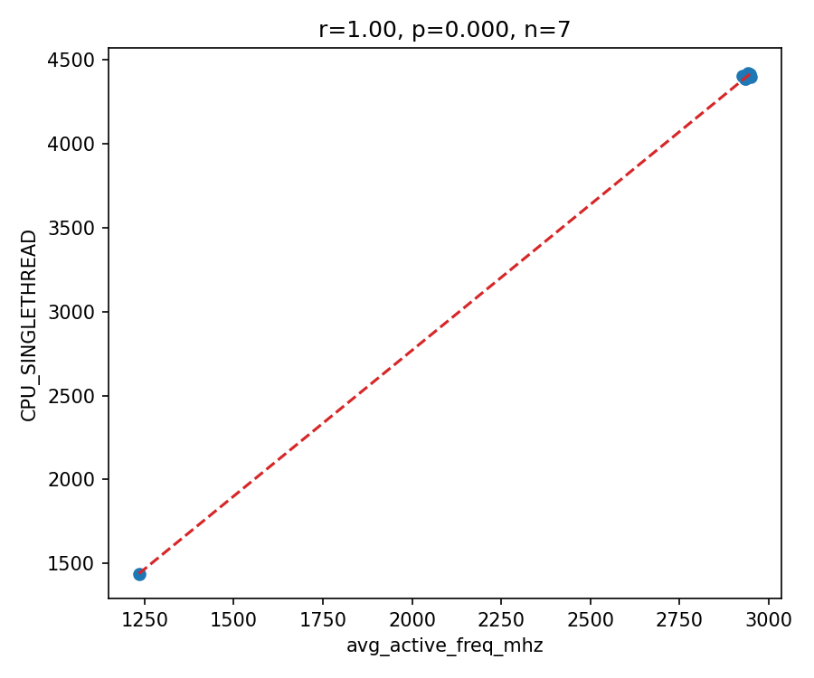

## How to Read This for SKU/Workload Behavior

- A **positive r between a score and average package power/frequency** suggests the workload scales with power/turbo headroom - i.e. the SKU is power- or frequency-limited for that sub-test, and raising power limits or cooling should move the score.
- A **flat/near-zero r** suggests the sub-test is bound by something else telemetry here doesn't capture well (e.g., disk I/O, memory latency).
- A **negative r with C0 residency** can indicate the benchmark finishes faster at higher scores, or that runs with more idle/background interference score lower - inspect the specific run rows, don't over-interpret from r alone.
- To get statistically solid conclusions: run more repeats per configuration, vary one knob at a time, and keep workload identical across runs.
